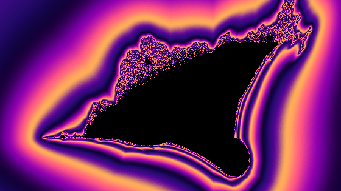
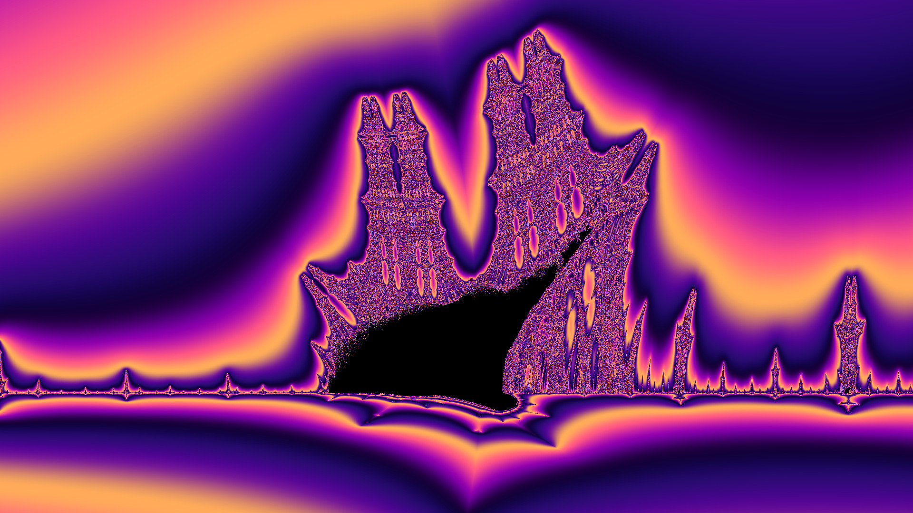
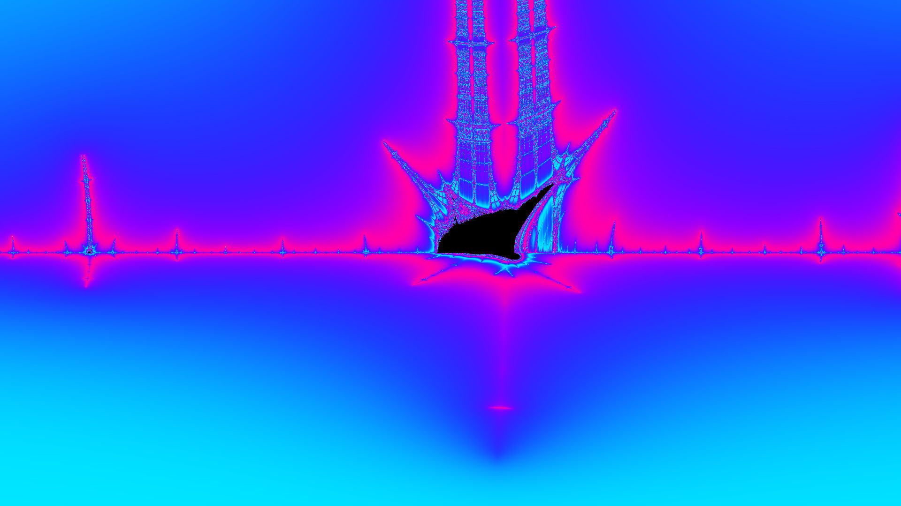
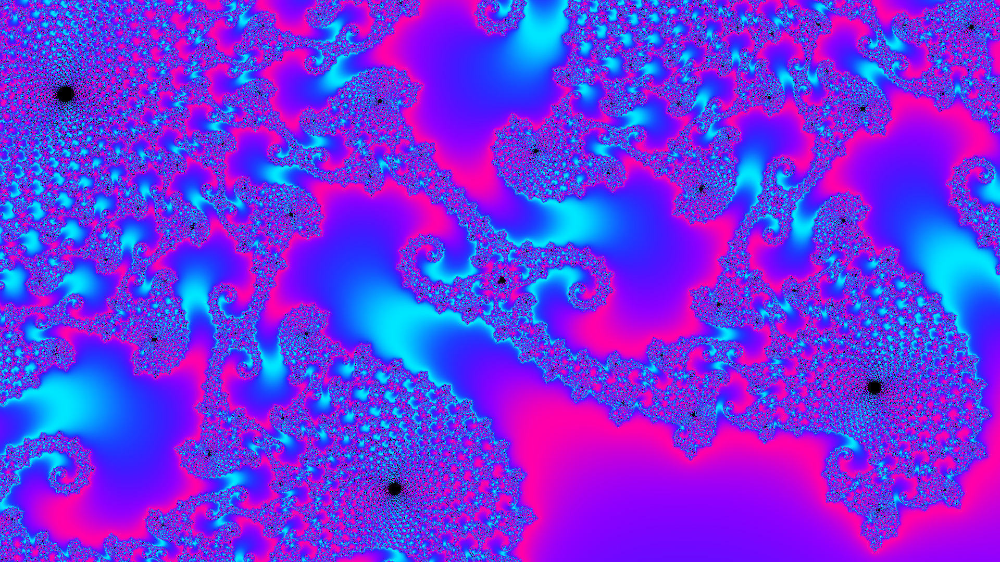
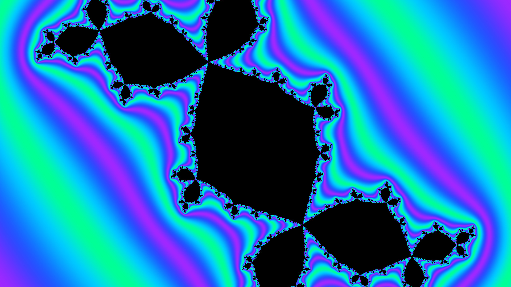
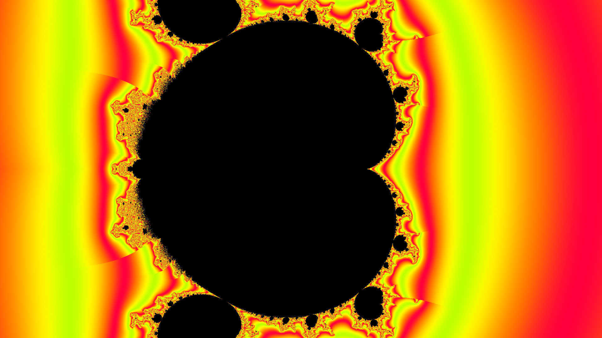
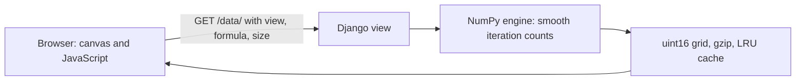

# fractol — an interactive fractal explorer

<p align="center">
  
</p>

**Live demo: <https://fractaldji.pythonanywhere.com/>**

Zoom into the Mandelbrot set, Julia sets and the Burning Ship right in your browser,
switch formulas, change the maths parameters and recolour everything in real time.
Built with **Python, NumPy and Django**.

It started as the *fract-ol* project of [42](https://42.fr) (originally C + MiniLibX)
and grew into a small web application: the maths runs on the server in NumPy, the
colours and the navigation run in the browser.

## Highlights

- **Five fractal families, one registry.** Mandelbrot, Julia, Multibrot, Burning Ship
  and Tricorn are described once in `formulas.py` (parameters, ranges, presets). The
  server validates requests against it and the page builds its controls from it, so
  adding a formula needs no UI code. 17 presets show the interesting places.
- **Smooth colouring.** Continuous iteration counts instead of integer bands, with 6
  palettes, 3 colouring modes and animated colour cycling. Changing colours is
  instant because the server sends iteration data, not pixels.
- **Fluid navigation.** Wheel zoom, drag and arrow keys. The current image is
  transformed instantly while a quarter-resolution preview is computed, and the full
  quality image arrives when you stop. Requests that became obsolete are cancelled on
  the server, so a single worker is not wasted on frames nobody will see.
- **Deep zoom** down to a window width of 1e-11 (about 10¹¹ times deeper than the
  start view), the practical limit of 64-bit floats.
- **Fast engine.** NumPy with a shrinking active set, `uint16` transport with gzip
  (about 11 times smaller than raw floats) and an LRU cache of recent views.
- **Tested and linted.** 109 Python tests and 8 JavaScript tests, `ruff`, `pre-commit`
  and conventional commits.

## Gallery

| | |
|---|---|
|  |  |
|  |  |
|  |  |

All images were rendered by the project itself (see [Regenerating the images](#regenerating-the-images)).

## How it works



1. The browser asks `/data/` for the area it is showing.
2. The engine iterates the formula for every pixel at once with NumPy and returns a
   *continuous* escape value (the fractional part removes visible banding).
3. Values are quantised to `uint16` (64 steps per iteration, `65535` marks points that
   never escape), gzipped and cached.
4. The browser maps values to colours through a 1024-entry palette table built with a
   cyclic Catmull-Rom spline, so palettes, modes and cycling never touch the server.

The same colour code exists in Python (`src/fractol/coloring.py`) for rendering images
from the terminal. A test compares it with the JavaScript version value by value.

## Performance

Measured on a shared cloud machine at 1000×700 pixels (the ratios matter more than the
absolute times). Run `python scripts/bench_engine.py` to measure your own machine.

| Case | Before | After |
|---|---|---|
| Initial Mandelbrot view | 688 ms | 301 ms |
| Deep spiral, 300 iterations | 3835 ms | 1016 ms |
| Worst case, 1200×840, 500 iterations | 7144 ms | 1852 ms |
| Initial `/data/` response | 2.8 MB | about 257 KB |

- The NumPy renderer is about 5-6 times faster than the pure Python one it replaced.
- In a simulated burst of 10 quick pans, cancelling obsolete work halves the total
  time (1.1 s to 0.55 s), and an abandoned full-quality request is dropped after
  0.33 s instead of running for 1.54 s.
- With the production limits used on the demo (900×630 pixels, 300 iterations) the
  worst case takes about 0.9 s.

## Run it locally

```bash
git clone https://github.com/Alassana-Djigo/fractol.git
cd fractol
python3 -m venv venv
source venv/bin/activate
pip install -e .
cp .env.example .env        # development settings (DEBUG=1)
python manage.py runserver
```

Open <http://127.0.0.1:8000/>. Python 3.12 or newer is required.

Development tools (tests, linting, git hooks):

```bash
python -m pip install --upgrade pip   # --group needs pip 25.1 or newer
pip install --group dev
pre-commit install
pytest
node --test tests/js/*.test.mjs
```

There is also a minimal Pygame window, the first milestone of the project (a static
Mandelbrot image): `pip install -e ".[desktop]"` then `python -m fractol.window`.

## API

| Endpoint | Description |
|---|---|
| `GET /` | The explorer page. |
| `GET /data/` | Escape values for a view, as a `uint16` grid (gzip when accepted). The `X-Nu-Scale` header gives the quantisation step and `X-Cache` tells whether the cache was used. |
| `GET /render/` | The same view as a ready-made PNG. |

Query parameters: `fractal` (`mandelbrot`, `julia`, `multibrot`, `burning_ship`,
`tricorn`), `cx`, `cy` (centre), `scale` (width of the view), `w`, `h` (pixels), `iter`
(maximum iterations) and the formula parameters (`power`, and `jr`, `ji` for Julia).
Every value is validated against the ranges declared in the registry; invalid
requests get a `400`. `/data/` also accepts `client` and `rid` so that an obsolete
request can be answered with `204` and abandoned.

## Configuration

Settings come from the environment or from a `.env` file (see `.env.example`). The
defaults are safe: debug is off, and without a `SECRET_KEY` the app refuses to start.

| Variable | Meaning | Default |
|---|---|---|
| `DEBUG` | `1` enables debug mode | `0` |
| `SECRET_KEY` | Django secret key (required when `DEBUG` is `0`) | none |
| `ALLOWED_HOSTS` | Comma-separated host names | `localhost,127.0.0.1` |
| `FRACTOL_MAX_SIZE` | Largest image width or height accepted | `1200` |
| `FRACTOL_MAX_ITER` | Largest iteration count accepted | `500` |
| `FRACTOL_CACHE_MB` | Size of the in-memory view cache | `64` |

The page reads the size and iteration limits from the server, so lowering them also
limits the controls.

## Deployment

The demo runs on the free tier of [PythonAnywhere](https://www.pythonanywhere.com/)
(one web worker), using WhiteNoise for static files and lower limits
(`FRACTOL_MAX_SIZE=900`, `FRACTOL_MAX_ITER=300`). The short version:

```bash
pip install -e .
python manage.py collectstatic --noinput
python manage.py check --deploy
```

then point the web app's WSGI file at `config.wsgi` and map `/static/` to
`staticfiles/`. `check --deploy` only reports the two HTTPS settings that the host
handles.

## Project layout

```text
src/fractol/    escape, formulas, fractals, render_np (engine), coloring, window
explorer/       Django app: views, cache, encoding, cancellation, templates, static JS
config/         Django settings (environment based), urls, wsgi
scripts/        benchmarks and the image/GIF gallery tool
tests/          Python tests and tests/js (viewport and colouring, run with node)
assets/gallery/ images and GIF used in this README
```

## Regenerating the images

```bash
python scripts/gallery.py list      # the scenes
python scripts/gallery.py images    # 1920x1080 JPEGs in assets/gallery
python scripts/gallery.py gif       # the zoom animation
```

## References

- [Mandelbrot set](https://en.wikipedia.org/wiki/Mandelbrot_set)
- [Julia set](https://en.wikipedia.org/wiki/Julia_set)
- [Burning Ship fractal](https://en.wikipedia.org/wiki/Burning_Ship_fractal)
- [Plotting algorithms for the Mandelbrot set](https://en.wikipedia.org/wiki/Plotting_algorithms_for_the_Mandelbrot_set) (smooth colouring)
